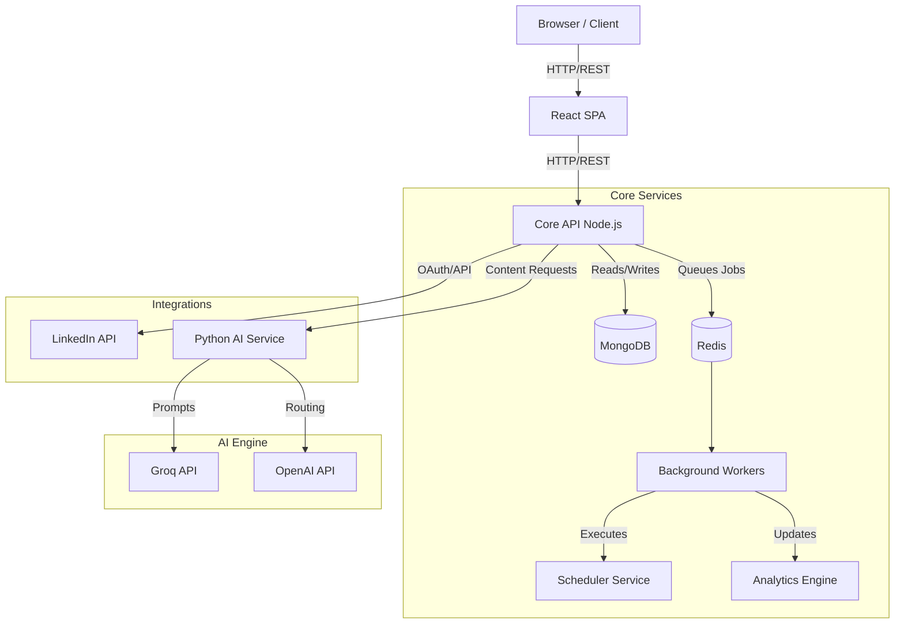
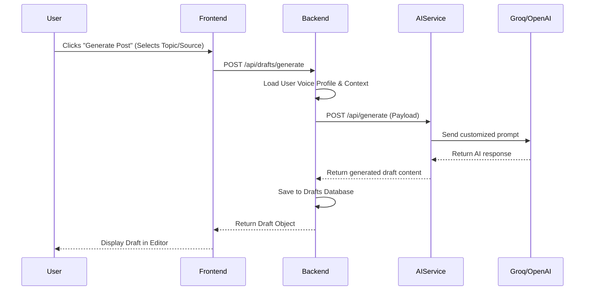
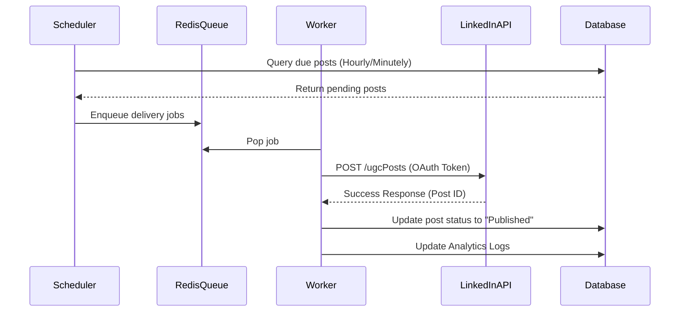

# Creator Pulse Platform Architecture Report

## 1. Executive Summary

Creator Pulse is a comprehensive content generation and scheduling platform designed to streamline LinkedIn content creation. The platform leverages advanced AI modeling to generate personalized, voice-trained content based on trends and user-provided sources. It features a robust multi-service architecture encompassing a frontend dashboard, a core API backend, and a dedicated AI generation service.

## 2. Technology Stack

### Frontend (User Interface)
* **Framework:** React 18, Vite
* **Routing:** React Router (v6)
* **State Management:** Zustand, React Query (TanStack)
* **Styling:** Tailwind CSS, Radix UI (shadcn/ui base)
* **Components:** Recharts for analytics, Embla Carousel for carousel previews
* **Language:** TypeScript

### Backend (Core API Service)
* **Framework:** Node.js, Express.js
* **Language:** TypeScript
* **Database:** MongoDB (via Mongoose/custom ODM), with PostgreSQL (via Drizzle ORM) for relational specific tasks
* **Message Queue:** Redis (via BullMQ) for background job processing
* **Authentication:** Custom JWT-based Auth, LinkedIn OAuth

### AI Microservice
* **Framework:** Python, FastAPI
* **Model Integration:** Groq API Proxy, OpenAI routing
* **Functionality:** Voice training analysis, drafting, content ideation, and generation

## 3. Architecture Overview

The system is built on a microservices-inspired monorepo architecture:

1. **Frontend App (`@workspace/creatorpulse`):** The client-facing Single Page Application (SPA).
2. **Core API Server (`backend`):** The main orchestration engine handling data persistence, scheduling, integrations (LinkedIn), and user management.
3. **AI Service (`ai-service`):** A specialized Python API handling intensive AI generation tasks.

## 4. Feature Modules & Capabilities

### 4.1 Content Intelligence & Sourcing
* **Sources & Trends:** Users can ingest content from external URLs or manually input data. The system scrapes and parses these sources for relevant trends.
* **Voice Training:** Dedicated interface to analyze a user's past writing to instruct the AI on maintaining a consistent brand voice.

### 4.2 Content Generation & Drafts
* **AI Generation Workflow:** Uses the Python AI microservice to transform ingested sources and trends into actionable LinkedIn posts.
* **Carousels Engine:** Native support for rendering and managing multi-slide LinkedIn carousels.

### 4.3 Scheduling & Delivery
* **Delivery Engine:** An interactive scheduler that queues posts for automatic delivery via the LinkedIn API.
* **Background Processing:** Cron-based and queue-based (BullMQ) workers execute the deliveries precisely when scheduled without blocking the main API thread.

## 5. Workflow Diagrams

### 5.1 Post Generation Data Flow

### 5.2 Automated Delivery Flow

## 6. Recommendations & Next Steps
* **Monitoring:** Ensure the `EngineMonitor` on the frontend is tightly coupled with health checks from both the Node.js and Python backends.
* **Scaling:** Redis and MongoDB instances should be properly provisioned to handle the load of periodic background jobs. The Python AI service can be scaled independently if generation requests bottleneck.
* **Testing:** Maintain robust end-to-end testing across the boundary of the Core API and the AI Service to prevent generation mismatches.
